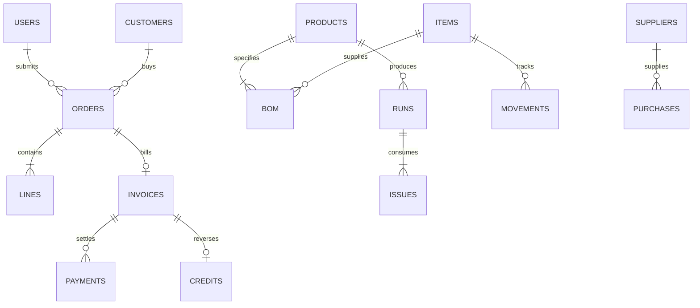

# Millbook design note

## Source documents and stock

A movement stores a signed quantity, inventory value for purchased inputs, posting day, item and source reference. Opening stock, purchase, run and dispatch use distinct source prefixes. Recipe lines store standard quantities in grams, millilitres or whole pieces. Product master rows define expected packets per batch, selling price, tax rate and carton size. Movements are append-only through the application. Finished goods are quantity-tracked. Their production costs live on run issues and overheads.

## Posting rules

A purchase writes its receipt and positive movement together. A run snapshots planned and actual input quantities. It checks each input balance, posts input issues, then adds good packets. Pouch issues equal good packets plus damaged pouches. Carton issues are entered independently. Expected yield equals batches × standard packets. Each variance equals 100 × (actual − standard) / standard. The floor sees flags on either side of a 3% tolerance. Overhead revisions log the actor, UTC time and new amounts.

Approval reserves stock by order line. Available stock equals on-hand packets minus quantities on approved or invoiced orders. Dispatch posts the invoice-referenced movement and ends its reservation in the same transaction. A full credit cancels an unpaid, undispatched invoice, releases its reservation and reverses the sales and GST figures on the credit posting date. Collections settle one invoice. Ageing uses invoice age and payments posted through the selected end date.

## Cost, precision and integrity

Purchased materials use perpetual moving weighted average. Issue value is the pre-issue stock value multiplied by issued quantity divided by pre-issue stock quantity. Round the extended issue value once to the nearest paisa, half-up. This blends receipt prices while preserving historical run cost. Labour and gas/power are directly attributed to the selected run. Divide total material, packaging and overhead cost by good output. Margin uses the product's pre-tax list price.

SQLite serializes writes with BEGIN IMMEDIATE. One transaction contains the business document, all its movements, audit event and request key. Failure rolls everything back. A retry with the same key cannot create another posting. Quantities are stored in integer base units and money in integer paise. Server-side role checks govern both data reads and writes. Orders remain editable through verification; posted invoice lines and run issues cannot be edited through the application.
